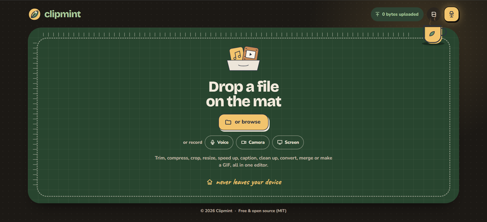

# Clipmint

Clipmint is a browser-based audio and video toolkit. It converts, edits and compresses media with
FFmpeg compiled to WebAssembly, so files are processed on your own device.



## Features

### Audio tools

- Convert between common audio formats.
- Trim and cut on a waveform.
- Merge several files into one, with an optional crossfade and fades at the ends.
- Set the bitrate, sample rate and channels.
- Normalize loudness, add fades and change the speed with the pitch kept.

### Video tools

- Compress to a quality level or a size limit (25 MB for chat apps, 10 MB for email), and resize.
- Trim and crop.
- Extract the audio track, turn the sound off, or add music under it or in place of it.
- Turn clips into GIFs.
- Change the playback speed, rotate and mirror.
- Export presets for social platforms: TikTok, Instagram Reels and posts, YouTube Shorts, Facebook, X
  and WhatsApp Status.
- Merge clips into one video, with an optional fade. Clips of the same format, kept whole, join without
  re-encoding. Clips of different sizes are fitted with bars or cropped to fill.
- Add text and a logo, for the whole video or its first or last 3 seconds.
- Pick a thumbnail from the best frames and save it as JPG or PNG.

### AI-assisted and automatic tools

- Speech transcription (.srt, .vtt, .txt) and burned-in captions, using Whisper (tiny, or base for
  better accuracy in languages other than English).
- Caption styles: Pop (the spoken word lights up), One word, Classic and Boxed, with a highlight colour,
  size and position, previewed live over the video.
- Burned-in captions and text work in Latin, Cyrillic, Greek, Bengali, Devanagari, Arabic, Japanese,
  Korean and Chinese. The fonts load only when the text needs them.
- Jump cuts: long pauses are cut out of a talking video, picture and sound together.
- Noise reduction for speech, using RNNoise.
- Silence trimming for audio (quiet ends, or every long pause).
- "Good bit": picks the liveliest part of a clip from its loudness (also used by "Make 3 shorts").
- Face-aware cropping that follows the main face, using MediaPipe.
- Blur faces: finds and follows up to six faces. The AI can miss a face, so check the result before
  sharing it.
- Cut by text: tap words in the transcript to cut them from the video, or remove filler words. Words
  next to a pause cut cleanly; in fast speech a cut can clip the word beside it.
- Cut on the beat: takes turns between clips in time with a song.
- Caption translation, in browsers with the built-in Translator API (Chrome and Edge 138+).

The models run in the browser and are served by the site itself. Caption translation is the exception:
it uses the browser's own translator, and the browser downloads that language pack itself.

### Getting files in and out

- Drop, browse, paste a copied file (Ctrl/⌘+V), or record the microphone, camera or screen in the page.
- Installed as an app on a phone, Clipmint appears in the share sheet, and results can be shared straight
  to another app (WhatsApp, Messages…).

### Editing workflow

- Several edits (for example trim, crop, speed and captions) combine into one export. The output
  settings (format, size, quality) sit under every tool in one "Export" panel.
- Captions can be heard and corrected before they're burned in, or come from your own .srt or .vtt file.
- Clean up and Normalize play a 10-second before/after sample.
- "Make 3 shorts" cuts the liveliest parts of a finished video into separate clips.
- Undo and redo, plus keyboard shortcuts (Space, I/O, arrows, Ctrl/⌘+Z, Ctrl/⌘+Enter; `?` lists them).
- Several files of the same kind can be processed as a batch and downloaded as a .zip.
- The desk is kept through a refresh. The empty desk offers "Continue editing", and its × removes the
  saved work (with a few seconds to undo).
- Light and dark themes (the desk lamp in the header).

Supported formats, browser support and limits are listed in [docs/REFERENCE.md](docs/REFERENCE.md).

## Privacy

Media is processed locally in the browser. Files are never sent to a Clipmint server; the site is
static and has no server-side processing. The app does download its own code, the FFmpeg core and,
when a feature needs them, the AI models, all from the site it is served from. Recordings from the
microphone, camera or screen are made in the page and stay on the device too. Work in progress is
kept in the browser so a refresh doesn't lose it, until you start a new file or remove it. The header
shows a live count of the bytes the page has uploaded (it stays at 0). There are no accounts,
analytics or cookies. Finished work offers a "privacy receipt", a text record of what the page counted.
See the in-app `/privacy` page for details.

The only service worker (`public/sw.js`) receives files shared to the installed app and hands them to
the page. It caches nothing else and does not make the app work offline.

## Requirements

- Node.js 20 or newer (`.nvmrc` pins 22) and npm.
- A browser with WebAssembly SIMD: Chrome/Edge 91+, Firefox 114+ or Safari 16.4+.
- Captions run faster where the browser has WebGPU; otherwise they run on the CPU.
- Recording needs HTTPS (or `localhost`). Screen recording is desktop only.
- Sharing into Clipmint needs the app installed from the browser (Android). Sharing results out works
  where the browser supports sharing files, which is mostly phones.

## Run Locally

```bash
npm install
npm run dev
```

Then open `http://localhost:3000` in your browser.

The first start needs an internet connection: it downloads the speech models used for captions
(about 300 MB, once). To download only the smaller one, set the environment variable
`CLIPMINT_SPEECH_MODELS=tiny` before starting; the "better" accuracy option is then not offered.

## For developers

See [docs/ARCHITECTURE.md](docs/ARCHITECTURE.md) for how it's built, and
[docs/REFERENCE.md](docs/REFERENCE.md) for formats, limits, build and deploy.

## License

The Clipmint source code is licensed under the [MIT License](LICENSE).

Some bundled third-party components have their own licenses. The FFmpeg WebAssembly core
(`@ffmpeg/core`) is GPL-2.0-or-later, because it is built with GPL components such as libx264 and
libx265. Anyone who hosts Clipmint serves that core to users and must meet the GPL's terms for it. The speech,
face-detection and noise-reduction models and the caption font are also third-party. See
[License notes](docs/REFERENCE.md#license-notes) and [On-device models](docs/REFERENCE.md#on-device-models)
in the reference before redistributing.
